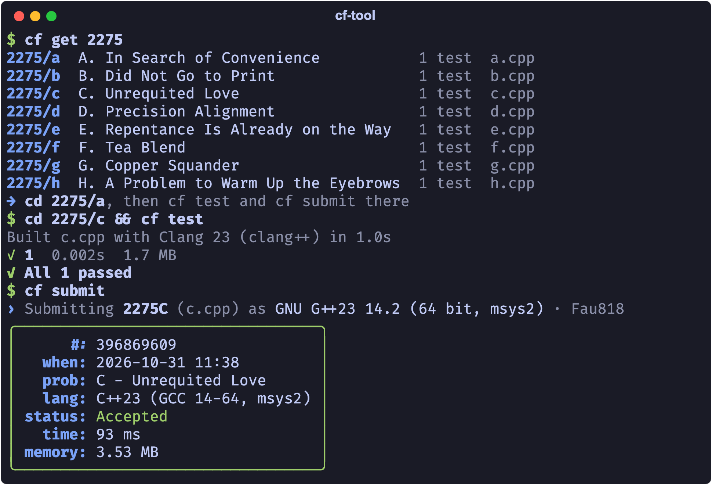
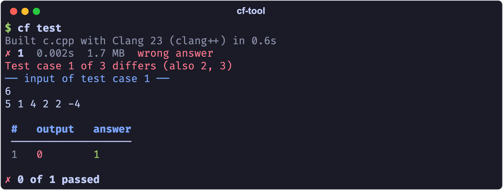
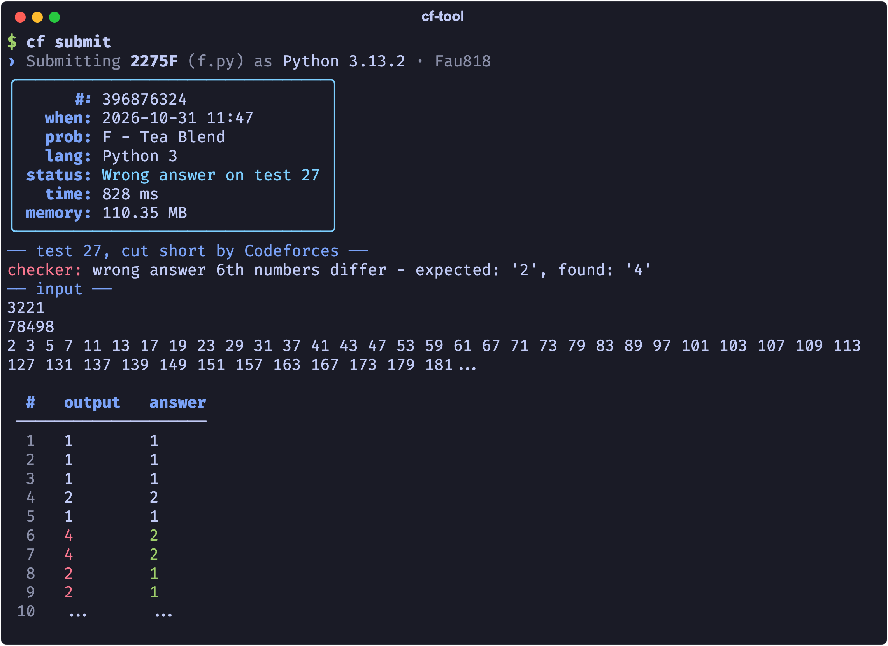
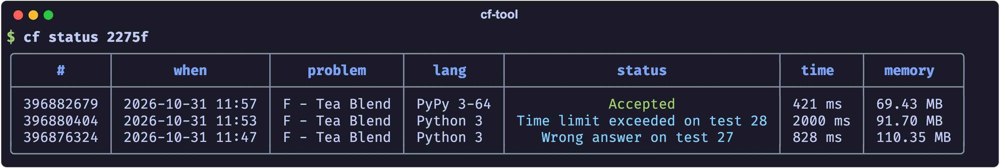

# cf-tool

[](https://github.com/Fau818/cf-tool/actions/workflows/ci.yml)
[](https://pypi.org/project/cf-tool-cli/)

Codeforces from your terminal: get a contest, test your code on the samples, submit, and
watch the verdict. No setup first.



## Install

```bash
uv tool install cf-tool-cli   # or: pipx install cf-tool-cli
```

You need Python 3.10+, a compiler or interpreter for your language, and Google Chrome to
log in (it works in the background).

## A contest, start to finish

**`cf get 2050`** makes a folder per problem: the statement, the samples and your starter
code. The first time, cf asks which language you write in.

**`cf test`** builds your code and runs it on the samples. A wrong answer shows the input
and where your output parts from the answer, down to the test case:



**`cf submit`** sends it and shows the verdict as it comes. Once the contest is over, a
failed test comes with it, as Codeforces keeps it, and is saved for `cf test`:



**`cf status`** lists your submissions, refreshed until they're judged:



## Commands

| Command | What it does |
| --- | --- |
| `cf get 2050` / `cf get 2050b` | folders, samples and starter code for a contest or a problem |
| `cf test [problem] [test...]` | build your code and run it on the problem's tests (`-w`: on every save) |
| `cf submit [problem] [file]` | submit, then watch the verdict |
| `cf status [submission]` | your submissions, or one with the test it failed |
| `cf stress` | random tests until your code and a brute force disagree |
| `cf race 2050` | count down to the start, then get the problems |
| `cf open` / `cf problems` / `cf contests` | the problem in the browser, a contest's problems, upcoming contests |
| `cf pick -r 1600 -t dp` | a random problem you haven't solved |
| `cf new` / `cf listen` | a code file from your starter code; problems from Competitive Companion |
| `cf pull` / `cf clone` | download the code of your (or anyone's) submissions |
| `cf login` / `cf config` / `cf doctor` | log in; settings from menus; check the setup |

More in the [guide](https://github.com/Fau818/cf-tool/blob/main/docs/guide.md): your own
tests, checkers, interactive problems, settings, CP Editor, Tab completion, coming from
cf-tool 0.3.

## License

MIT. cf-tool began as a port of [xalanq/cf-tool](https://github.com/xalanq/cf-tool).
